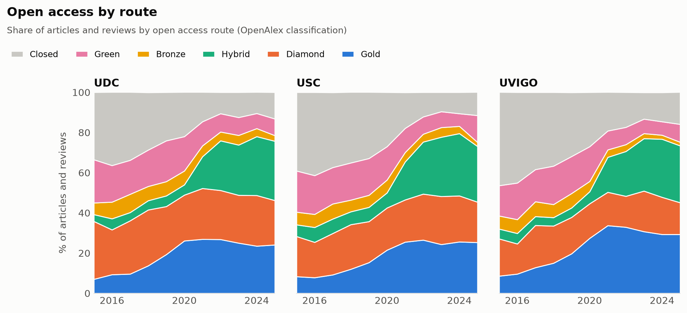
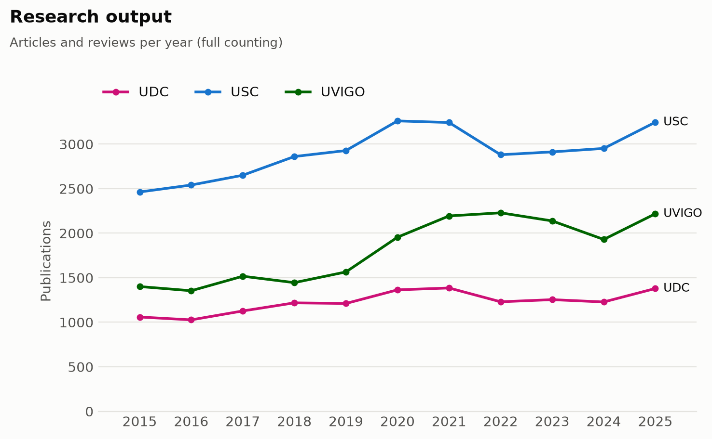
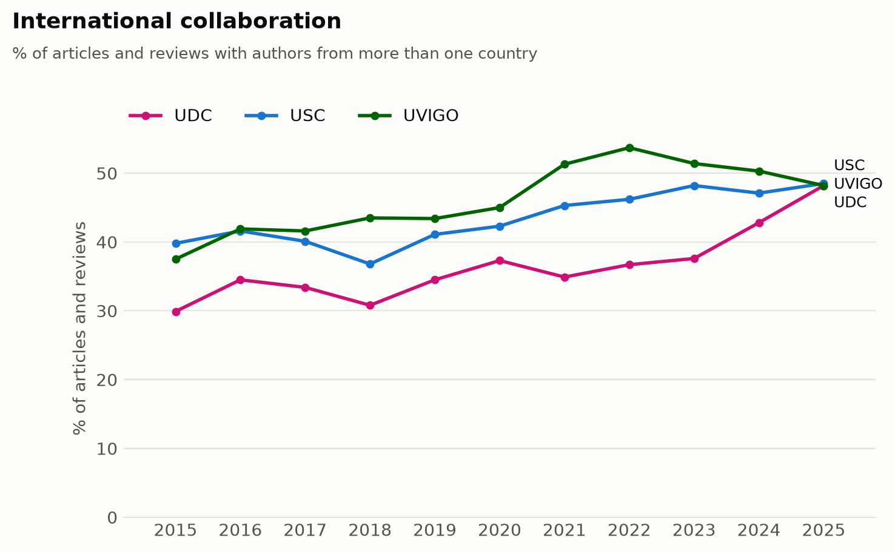
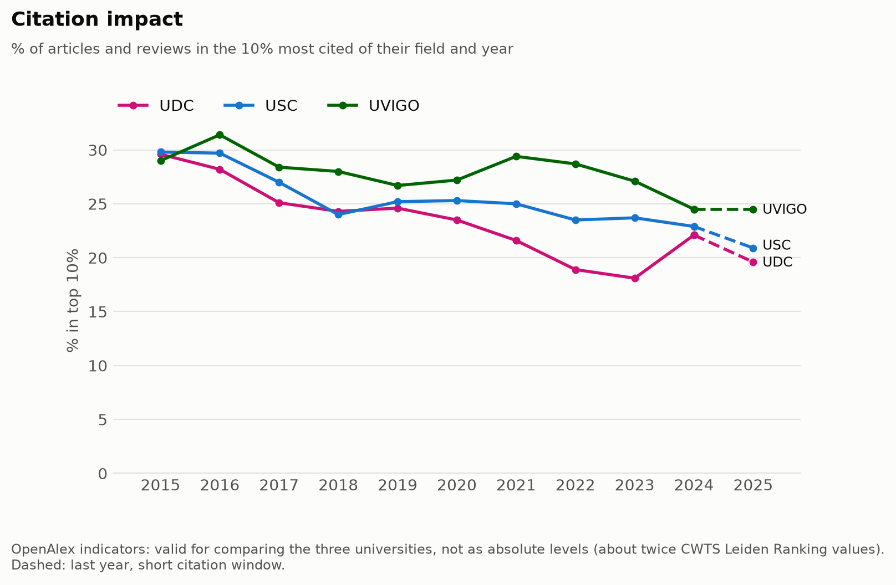
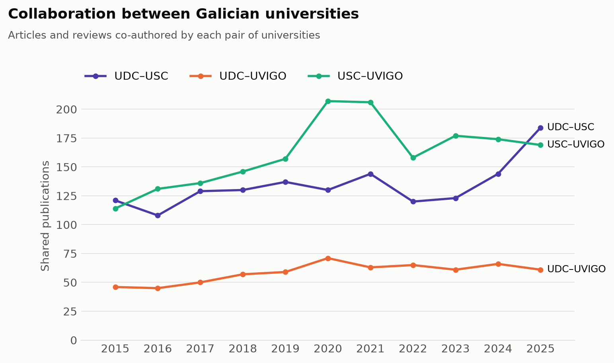

# Research output of the Galician universities (2015–2025)

An end-to-end bibliometric analysis of the three public universities of Galicia (Spain) — Universidade da Coruña (UDC), Universidade de Santiago de Compostela (USC) and Universidade de Vigo (UVIGO) — built on open data from [OpenAlex](https://openalex.org).

The project covers the full data workflow: **extraction** from a REST API, **cleaning** and modelling with pandas, **loading** into a SQLite database, **indicators in SQL**, **charts** with matplotlib, and **validation** of the results against an external reference, the [CWTS Leiden Ranking Open Edition](https://open.leidenranking.com).

> Personal project based on open data. Figures are not official statistics of any of the universities.

## Key findings

- **Open access has grown sharply**: at UDC, from 66.5% of articles in 2015 to about 89% in 2022–2024. The main driver from 2021 is **hybrid** open access, which jumps at all three universities at the same time, consistent with the CRUE-CSIC transformative agreements with major publishers.
- **International collaboration converges**: UDC rises from 30% (2015) to 48% (2025), reaching the level of USC and UVIGO. A check by number of countries shows the rise is specific to UDC and broad-based, not driven by a few mega-collaborations.
- **Citation impact**: UVIGO is ahead of USC and UDC every year from 2016. The ranking of the three universities matches the Leiden Ranking, but OpenAlex's own impact indicators are about **twice as high** as CWTS's, so only relative comparisons are reported.
- **USC is the hub of the Galician system**: it takes part in the two strongest collaboration pairs, while UDC–UVIGO is clearly the weakest.



<details>
<summary><b>More charts</b></summary>






</details>

## How the data was checked

A good part of the work went into testing the data instead of taking it at face value:

- **External validation.** Publication counts, international collaboration and most open access routes match the CWTS Leiden Ranking Open Edition 2025, which uses the same source (UDC publication count within 1.6%). Impact indicators do not match in level, and the differences between OpenAlex's FWCI and CWTS's MNCS were traced to their methodology (reference set, field definition, self-citations).
- **Hypotheses tested and documented**, including two that turned out to be wrong: the high share of *diamond* open access looked like a classification error, but comes mostly from Spanish university journals; the 2024–2025 rise in UDC's international collaboration looked like a possible data artefact, but appears to be real.
- **Robust indicators**: citation data is highly skewed (a single paper reaches an FWCI of 767), so medians and top 10% shares are reported next to means.

The full record of decisions, checks and results is in [`docs/findings.md`](docs/findings.md).

## Data and method

- **Source**: OpenAlex API, works with at least one author affiliated with each university or its child institutions, 2015–2025.
- **Document types**: articles and reviews (the core of the analysis) and conference papers (reported separately).
- **Counting**: full counting. 70,959 records correspond to 66,972 unique works; works shared between universities are stored once, with a separate table linking works to universities.
- **Data model**: two tables, `works` and `work_universities`, described in the [data dictionary](docs/data_dictionary.md).

## Pipeline

```
OpenAlex API ──> extract.py ──> data/raw/*.jsonl          raw records, as returned by the API
                 transform.py ──> data/clean/*.csv        flat, deduplicated tables
                 load.py ──> data/openalex.db             SQLite database with schema and keys
                 run_queries.py ──> results/*.csv         one indicator per SQL file
                 make_figures.py ──> figures/*.png        charts
```

## Project structure

```
src/            Python scripts: pipeline steps and exploration (explore_*.py)
sql/            Database schema and indicator queries (01_ … 06_)
sql/checks/     Data quality checks and the Leiden Ranking comparison
results/        Indicator tables (CSV)
figures/        Charts
docs/           Data dictionary and analysis log
```

## How to run it

Requires Python 3.10+ and a free [OpenAlex API key](https://openalex.org/settings/api).

```bash
git clone https://github.com/BorjaLafuente/openalex-galician-universities.git
cd openalex-galician-universities
python -m venv .venv
source .venv/Scripts/activate      # Windows (Git Bash); on macOS/Linux: source .venv/bin/activate
pip install -r requirements.txt
```

Create a `.env` file in the project root with your key:

```
OPENALEX_API_KEY=your_key
```

Then run the pipeline in order:

```bash
python src/extract.py       # downloads about 71,000 records (10–15 minutes)
python src/transform.py
python src/load.py
python src/run_queries.py
python src/make_figures.py
```

The data (`data/`) is not included in the repository: it is regenerated by the pipeline. Because OpenAlex is updated continuously, a new run may give slightly different figures.

## Tech stack

Python (requests, pandas, matplotlib) · SQL (SQLite) · OpenAlex API · Git

## License

Code released under the [MIT License](LICENSE). Data from OpenAlex is available under CC0.

## Author

Borja Lafuente Rego — [LinkedIn](https://www.linkedin.com/in/borjalafuenterego/)
